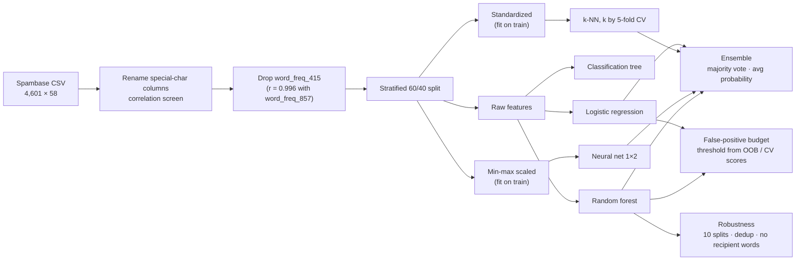

# Email Spam Detection: Comparing Five ML Classifiers + Ensemble

**Classifying email as spam or legitimate using word, character and capitalization frequencies, and choosing the operating point the way a mail-security team would: by how much legitimate mail it may block.**

[](https://github.com/casildata/email-spam-detection-ml/actions/workflows/pipeline.yml)


> **Origin:** a two-person graduate project in **Machine Learning** at Texas Tech University (2022), refactored and extended for publication.

---

## TL;DR

- **Data:** [UCI Spambase](https://archive.ics.uci.edu/dataset/94/spambase), 4,601 emails (39.4% spam) × 57 numeric features (frequencies of words like `free`, `remove`, `credit`; characters `!` `$`; runs of CAPITALS).
- **Best model:** Random forest, **94.95% validation accuracy**, against 79.46% for the best single rule and 61.74% for always answering "not spam". Over 10 random splits: 95.15% ± 0.54.
- **At a 1% false-positive budget** (threshold chosen on training data only), the forest catches **82.95% of spam** while flagging 11 of 1,136 legitimate emails. Logistic regression, close on accuracy (92.66%), catches only 49.43% at the same budget.
- **Audit findings:**
  - The 2022 k-NN was trained on data that included the validation rows: **93.70%** leaky vs **89.84%** fixed, on the same split.
  - 10.1% of validation emails have an exact duplicate in training.
  - Nine words that identify the original mailbox (`hp`, `george`, ...) are worth about **5 points of spam caught** at a 1% budget (80.89% → 75.86%).


---

## Approach

### Pipeline



### Why this matters for security

Spam filtering is the original ML-in-security problem, and the same pipeline shape carries over to phishing-email triage, malicious-attachment scoring, and alert classification. In a mail-security context the costs are asymmetric. A false positive (a real email quarantined) erodes trust in the filter and hides business mail; a false negative (spam or phish delivered) reaches the user. So the deciding question isn't accuracy but **how much spam is caught at a false-positive rate the business accepts**. The thresholds for that are chosen on training data only (random-forest out-of-bag votes, cross-validated logistic-regression scores) and checked once on the validation set.

## Results

All numbers below come from [`docs/results.md`](docs/results.md), which `Rscript run_all.R` regenerates; CI fails if any of them changes. Validation set: 1,840 emails (1,136 legitimate), a stratified 40% holdout.

### Model comparison

**Spam caught** is sensitivity; **false-positive rate** is the share of legitimate email flagged as spam.

| Model | Accuracy | Spam caught | False-positive rate | Notes |
|---|---|---|---|---|
| **Random forest** | **94.95%** | 92.19% | **3.35%** | Best overall |
| Ensemble: majority vote | 94.08% | 91.48% | 4.31% | Logit + kNN + ANN + RF; a 2–2 tie goes to the average probability |
| Ensemble: average probability | 93.97% | 91.19% | 4.31% | Logit + kNN + ANN + RF |
| Logistic regression | 92.66% | 92.76% | 7.39% | Probability cut-off tuned on training data |
| Neural network (1 hidden layer, 2 nodes) | 92.55% | 90.34% | 6.07% | Inputs min-max scaled on training data |
| k-NN (k = 5) | 89.84% | 84.09% | 6.60% | k chosen by 5-fold CV on training rows; fit on training rows only |
| Classification tree | 88.37% | 81.53% | 7.39% | Most interpretable |
| *Baseline: one rule* | *79.46%* | *75.85%* | *18.31%* | *Flag if `!` makes up at least 0.08% of characters (the best single split)* |
| *Baseline: always "not spam"* | *61.74%* | *0%* | *0%* | *The share of legitimate email* |

The models add about 15 points over the best one-line rule, and the ensembles don't beat the forest on its own. At its default 0.5 cut-off, though, even the forest flags 3.35% of legitimate email, roughly 1 in 30. That's too many for a mail filter, which is where the operating point comes in.

### Operating point: spam caught under a false-positive budget

| Model | Rule | Spam caught | False-positive rate | Legitimate emails flagged |
|---|---|---|---|---|
| Random forest | Default cut-off (0.5) | 92.19% | 3.35% | 38 of 1,136 |
| **Random forest** | **1% budget** | **82.95%** | **0.97%** | **11** |
| Random forest | 0.1% budget | 43.61% | 0.18% | 2 |
| Logistic regression | Accuracy cut-off (0.38) | 92.76% | 7.39% | 84 |
| Logistic regression | 1% budget | 49.43% | 1.14% | 13 |
| Logistic regression | 0.1% budget | 9.23% | 0.26% | 3 |

The models are close on accuracy, but far apart where a mail filter operates (ROC AUC 0.9887 vs 0.9697, average precision 0.9819 vs 0.9440). The forest's scores separate the most obvious spam cleanly; logistic regression's top scores mix in legitimate mail. Thresholds were set on training data, so the realized false-positive rate lands near the budget rather than exactly on it, as it would on next month's mail.

### Robustness: duplicates, recipient words and split-to-split variation

Random forest over 10 random stratified 60/40 splits (mean ± standard deviation):

| Version of the data | Emails | Accuracy | Spam caught at a 1% budget | Realized false-positive rate |
|---|---|---|---|---|
| All emails, all features | 4,601 | 95.15% ± 0.54 | 80.50% ± 3.40 | 0.74% ± 0.50 |
| Duplicates removed | 4,207 | 94.64% ± 0.40 | 80.89% ± 2.74 | 0.95% ± 0.40 |
| Duplicates removed, no recipient words | 4,207 | 93.54% ± 0.48 | 75.86% ± 4.12 | 0.94% ± 0.50 |

- **Duplicates** inflate accuracy by about half a point: 394 emails repeat an earlier one exactly, and on the main split the forest is right on 99.46% of the 185 validation emails with a twin in training, against 94.44% on the rest. They barely move spam caught at a fixed budget.
- **Recipient words** matter more. Spambase comes from one HP Labs mailbox, and words like `hp`, `george`, `650` and `telnet` identify *that* recipient. Without them, spam caught at a 1% budget drops by about 5 points. That's the closer estimate of how the filter would do on someone else's mail.
- **Split noise** is about ±0.5 points of accuracy and ±3–4 points of spam caught at a 1% budget, so differences smaller than that aren't findings.

| Random forest: top 15 features | Classification tree |
|---|---|
|  |  |

Both models lean on the same signals: `!` and `$` frequency, "remove", and runs of capital letters.

## Framework mapping

| Framework | Reference | How this repository relates |
|---|---|---|
| MITRE ATT&CK | [T1566 Phishing](https://attack.mitre.org/techniques/T1566/) | Context only: email is the delivery channel this layer filters. Spambase is bulk spam, not phishing, so no detection claim is made |
| CIS Controls v8.1 | 9.7 Deploy and Maintain Email Server Anti-Malware Protections | Content scoring at the mail server; 9.5 (DMARC) and 14.2 (social-engineering training) cover what content filtering misses |
| NIST CSF 2.0 | DE.CM-09; DE.AE-02 | Monitoring email content for adverse events; scoring and triaging what is flagged |

## Limitations & lessons learned

**The k-NN leak.** The original call was `knn(train = <full standardized dataset>, test = <validation rows>)`, so each validation email could find *itself* among its neighbours. On the main split, with k = 5: **93.70%** leaky vs **89.84%** fixed. An independent scikit-learn re-implementation over 20 random splits at k = 7 gives 92.8% ± 0.5 vs 89.8% ± 0.5 ([`analysis/knn_leakage_check.py`](analysis/knn_leakage_check.py)).

**Limitations of the data and the evaluation**

- **One mailbox from 1999.** Even without the recipient words, this is one person's 1990s mail. Modern phishing looks very different: fewer spammy words, more brand impersonation.
- **Pre-computed features only.** The data is 57 word and character frequencies, not raw text, so this model can't score a real email without re-deriving those features.
- **One validation set for the operating point.** The budget table uses the main split. The robustness table shows how much spam caught moves from split to split (±3–4 points), so read the operating-point numbers with that spread in mind.
- **Default model settings.** The forest uses 500 trees and default `mtry`; the neural network has one tiny hidden layer. Neither was tuned.

## Getting started

### Requirements

- R 4.5 or later (tested on 4.6.1; CI also runs the tests on 4.5). `neuralnet` depends on `Deriv`, which needs R 4.5.
- Optional, for the leakage check: Python 3.10 or later (tested on 3.14) with NumPy, pandas and scikit-learn (`analysis/requirements.txt`).
- Data ships with the repo in `data/raw/spambase.csv`.

### Install

The exact package versions used for the results are pinned in [`renv.lock`](renv.lock):

```r
install.packages("renv")
renv::restore()
```

Or install the current CRAN versions:

```r
install.packages(c("tidyverse", "caret", "FNN", "rpart", "rpart.plot",
                   "randomForest", "neuralnet", "testthat"))
```

```bash
pip install -r analysis/requirements.txt    # optional leakage check
```

The scripts never install anything. If a package is missing, they stop and print the command to run.

### Run

From the repository root:

```bash
Rscript run_all.R                                                 # all tables and figures
Rscript -e 'testthat::test_dir("tests/testthat")'                 # unit tests
python analysis/knn_leakage_check.py data/raw/spambase.csv        # optional leakage check
```

### Output

About 2 minutes, most of it the 30 random forests in the robustness check. `docs/results.md` and the figures in `docs/figures/` are regenerated (tracked). The metrics, operating points, robustness runs, cut-off tuning curves, correlation heatmap and validation predictions go to `outputs/` (git-ignored).

### Tests and CI

The unit tests cover the evaluation helpers (budget thresholds with ties, ROC AUC, average precision, duplicate detection), the metrics, and a k-NN leakage check. [GitHub Actions](.github/workflows/pipeline.yml) runs the tests and the full pipeline on every push and fails if any number in `docs/results.md` changes. It also runs the tests on R 4.5 and scans the history for secrets with gitleaks.

## Repository structure

```
email-spam-detection-ml/
├── run_all.R                   # runs scripts 01-03, writes docs/results.md
├── r-packages.txt              # R packages the scripts need
├── renv.lock                   # pinned package versions
├── R/
│   ├── check_packages.R        # stops with an install command if a package is missing
│   ├── functions.R             # cut-off tuning, confusion-matrix and metrics helpers, libraries
│   ├── evaluation.R            # budget thresholds, ROC AUC, average precision, duplicates
│   └── report.R                # markdown report helpers
├── scripts/
│   ├── 01_model_comparison.R   # 5 models + ensembles, baselines, k-NN leakage
│   ├── 02_operating_point.R    # spam caught under a false-positive budget
│   └── 03_robustness.R         # 10 splits, duplicates removed, no recipient words
├── tests/testthat/             # unit tests
├── analysis/
│   ├── knn_leakage_check.py    # independent leakage check (scikit-learn)
│   ├── check_requirements.py   # stops with the pip command if a package is missing
│   └── requirements.txt        # Python packages for the leakage check
├── data/
│   ├── README.md               # source, license, citation
│   └── raw/spambase.csv        # UCI Spambase (CC BY 4.0)
├── docs/
│   ├── results.md              # generated
│   └── figures/                # generated
├── outputs/                    # generated, .gitignored
├── .github/workflows/          # CI
├── CHANGELOG.md
└── LICENSE
```

## Skills demonstrated

`Supervised classification` · `Model comparison` · `Ensemble methods` · `Operating points under a false-positive budget` · `Leakage-free evaluation (OOB / cross-validated thresholds)` · `Data auditing (leakage, duplicates, recipient-specific features)` · `Testable analysis code, CI, renv` · `R` · `Python / scikit-learn`

## Roadmap

- Rebuild the features from raw email text and test on a modern phishing corpus (downloaded at run time), reported as spam caught at a 1% false-positive budget.
- Adversarial check: pad spam with words typical of legitimate mail, or strip `!` and `$`, and measure how much spam caught drops.
- A text model (TF-IDF with logistic regression or gradient boosting) on a raw-text corpus as the modern comparison.
- Score `.eml` files from the command line.

## Data & citations

Hopkins, M., Reeber, E., Forman, G., & Suermondt, J. (1999). *Spambase* [Dataset]. UCI Machine Learning Repository. https://doi.org/10.24432/C53G6X. Licensed CC BY 4.0.

## Credits & Collaboration

The original 2022 analysis was a two-person graduate project in Machine Learning at Texas Tech University.

* **Javier Casildo**
* **Team Member:** one collaborator (name omitted for privacy)

*Note: Team member profiles will be linked with their permission.*

## License

Code: MIT. See [LICENSE](LICENSE). Dataset: CC BY 4.0 (UCI).
