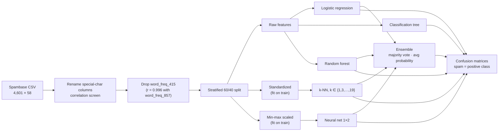

# Email Spam Detection: Comparing Five ML Classifiers + Ensemble

**Classifying email as spam or legitimate using word, character and capitalization frequencies. This is the content-filtering layer behind phishing and spam defenses.**


> **Origin:** a two-person graduate project in **Machine Learning** at Texas Tech University (2022), refactored for publication.

---

## TL;DR

- **Data:** [UCI Spambase](https://archive.ics.uci.edu/dataset/94/spambase), 4,601 emails (39.4% spam) × 57 numeric features (frequencies of words like `free`, `remove`, `credit`; characters `!` `$`; runs of CAPITALS).
- **Best model:** Random forest, **94.95% validation accuracy**. The majority-vote ensemble reaches 94.08%.
- **Audit finding:** while preparing this repo I found that the kNN model had been fit on data that included the validation rows. A Python re-check shows this inflated kNN accuracy from **~89.8% to ~92.8%**. The code is fixed and the check is included ([`analysis/knn_leakage_check.py`](analysis/knn_leakage_check.py)).

---

## Approach

### Pipeline



### Why this matters for security

Spam filtering is the original ML-in-security problem, and the same pipeline shape carries over to phishing-email triage, malicious-attachment scoring, and alert classification. In a mail-security context the costs are asymmetric: a false positive (a real email quarantined) costs differently from a false negative (phish delivered). That is why this project reports sensitivity and specificity instead of accuracy alone, and why the cut-off is tuned rather than fixed at 0.5.

## Results

Validation accuracy on a 40% stratified holdout, from `Rscript scripts/spam_classifier.R` with the leakage and ensemble fixes applied. The run is seeded (`set.seed(1)`), so re-running it reproduces these numbers.

| Model | Validation accuracy | Notes |
|---|---|---|
| **Random forest** | **94.95%** | Best overall |
| Ensemble: majority vote | 94.08% | Logit + kNN + ANN + RF; a 2–2 tie goes to the average probability |
| Ensemble: average probability | 93.91% | Logit + kNN + ANN + RF |
| Logistic regression | 92.66% | Probability cut-off tuned on training data |
| Neural network (1 hidden layer, 2 nodes) | 92.55% | Inputs min-max scaled on training data |
| k-NN (k = 7) | 90.54% | Fit on training rows only; the original leaky fit scored 92.29% (see below) |
| Classification tree | 88.37% | Most interpretable |

| Random forest: top 15 features | Classification tree |
|---|---|
|  |  |

Both models lean on the same signals: `!` and `$` frequency, "remove", and runs of capital letters.

## Limitations & lessons learned

**Why the kNN number changed.** The original call was `knn(train = <full standardized dataset>, test = <validation rows>)`, so each validation email could find *itself* among its neighbours. Re-implemented in scikit-learn over 20 random 60/40 splits: leaky setup **92.8% ± 0.5%**, correct setup **89.8% ± 0.5%**.

## Getting started

### Requirements

- R 4.5 or later (tested on 4.6.1) with the packages below (`neuralnet` depends on `Deriv`, which needs R 4.5).
- Optional, for the leakage check: Python 3.10 or later (tested on 3.14) with NumPy, pandas and scikit-learn (`analysis/requirements.txt`, installed automatically if missing).
- Data ships with the repo in `data/raw/spambase.csv`.

### Install

Missing packages are installed automatically the first time you run the scripts; an interactive R session (RStudio, VS Code) asks first. The list lives in [`r-packages.txt`](r-packages.txt). To install everything up front instead:

```r
install.packages(c("tidyverse", "caret", "forecast", "FNN", "rpart", "rpart.plot",
                   "randomForest", "reshape", "neuralnet"))
```

### Run

From the repository root:

```bash
Rscript scripts/spam_classifier.R
python analysis/knn_leakage_check.py data/raw/spambase.csv        # optional leakage check
```

### Output

The tree and feature-importance figures are written to `docs/figures/` (tracked, shown above). The correlation heatmap, the cut-off tuning curves for logistic regression and the neural network, and the validation predictions are written to `outputs/` (git-ignored).

## Repository structure

```
email-spam-detection-ml/
├── r-packages.txt              # R packages (installed automatically if missing)
├── R/
│   ├── check_packages.R        # installs missing packages from r-packages.txt
│   └── functions.R             # cut-off tuning, confusion-matrix helper, libraries
├── scripts/spam_classifier.R   # end-to-end: EDA → 5 models → ensemble
├── analysis/
│   ├── knn_leakage_check.py    # reproduces the kNN leakage finding (scikit-learn)
│   ├── check_requirements.py   # installs missing Python packages
│   └── requirements.txt        # Python packages for the leakage check
├── data/
│   ├── README.md               # source, license, citation
│   └── raw/spambase.csv        # UCI Spambase (CC BY 4.0)
├── docs/figures/               # README figures (tree, feature importance, heatmap)
├── outputs/                    # generated, .gitignored
├── CHANGELOG.md
└── LICENSE
```

## Skills demonstrated

`Supervised classification` · `Model comparison` · `Ensemble methods` · `Feature scaling without leakage` · `Hyperparameter / threshold tuning` · `Code audit & reproducibility` · `R` · `Python / scikit-learn`

## Data & citations

Hopkins, M., Reeber, E., Forman, G., & Suermondt, J. (1999). *Spambase* [Dataset]. UCI Machine Learning Repository. https://doi.org/10.24432/C53G6X. Licensed CC BY 4.0.

## Credits & Collaboration

The original 2022 analysis was a two-person graduate project in Machine Learning at Texas Tech University.

* **Javier Casildo**
* **Team Member:** one collaborator (name omitted for privacy)

*Note: Team member profiles will be linked with their permission.*

## License

Code: MIT. See [LICENSE](LICENSE). Dataset: CC BY 4.0 (UCI).
