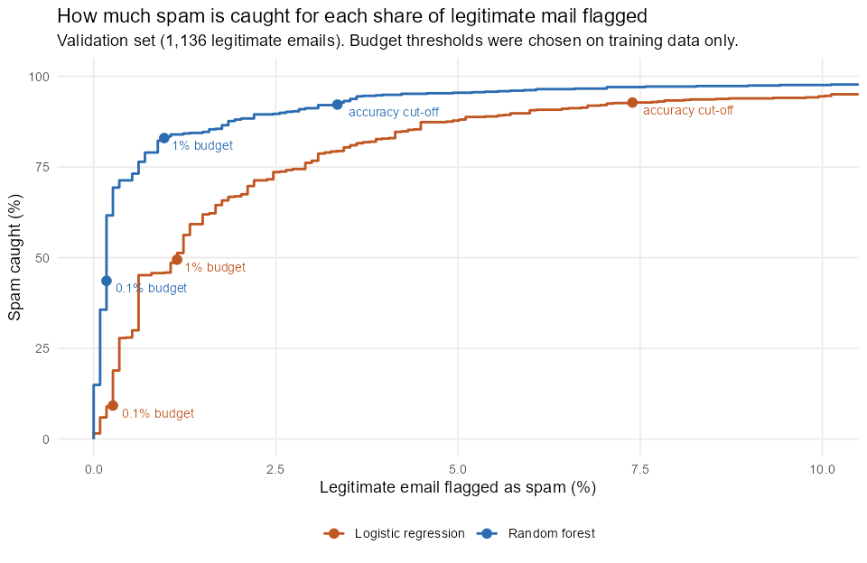

# Results

Generated by `Rscript run_all.R` from UCI Spambase (see `data/README.md`).
Percentages are on the validation set unless a row says otherwise.

## 1. Model comparison

4,601 emails, 39.4% spam. `word_freq_415` is dropped (r = 0.996 with `word_freq_857`). Stratified 60/40 split: 2,761 training and 1,840 validation emails (1,136 legitimate).

**Spam caught** is sensitivity; **false-positive rate** is the share of legitimate email flagged as spam (1 - specificity). Cut-offs: 0.5 for the forest and tree; tuned for accuracy on training predictions for logistic regression and the neural network.

| Model | Accuracy | Spam caught | False-positive rate |
|---|---|---|---|
| Random forest | 94.95 | 92.19 | 3.35 |
| Ensemble: majority vote | 94.08 | 91.48 | 4.31 |
| Ensemble: average probability | 93.97 | 91.19 | 4.31 |
| Logistic regression | 92.66 | 92.76 | 7.39 |
| Neural network | 92.55 | 90.34 | 6.07 |
| k-NN (k = 5) | 89.84 | 84.09 | 6.60 |
| Classification tree | 88.37 | 81.53 | 7.39 |
| Baseline: one rule | 79.46 | 75.85 | 18.31 |
| Baseline: always not spam | 61.74 | 0.00 | 0.00 |

One-rule baseline: flag the email if `char_freq_excl >= 0.08` (the best single split).

**k for k-NN** was chosen by 5-fold cross-validation on the training rows: k = 5 (CV accuracy 90.55%).

**k-NN leakage (the 2022 bug), same split and k:** trained on all rows 93.70%, trained on training rows only 89.84%.

## 2. Operating point: spam caught under a false-positive budget

Thresholds for a budget come from training data only: the random forest's out-of-bag votes and 5-fold cross-validated logistic-regression probabilities. They are then applied once to the validation set (1,136 legitimate emails). The realized false-positive rate can land a little above or below the budget, as it would on next month's mail.

| Model | Rule | Threshold | Spam caught | False-positive rate | Legitimate emails flagged |
|---|---|---|---|---|---|
| Random forest | Accuracy cut-off | 0.500 | 92.19 | 3.35 | 38 |
| Random forest | 1% budget | 0.706 | 82.95 | 0.97 | 11 |
| Random forest | 0.1% budget | 0.963 | 43.61 | 0.18 | 2 |
| Logistic regression | Accuracy cut-off | 0.380 | 92.76 | 7.39 | 84 |
| Logistic regression | 1% budget | 0.977 | 49.43 | 1.14 | 13 |
| Logistic regression | 0.1% budget | 1.000 | 9.23 | 0.26 | 3 |

| Model | ROC AUC | Average precision |
|---|---|---|
| Random forest | 0.9887 | 0.9819 |
| Logistic regression | 0.9697 | 0.9440 |

## 3. Robustness

**Duplicates.** 394 of the 4,601 emails repeat an earlier email's feature vector exactly (4,207 distinct vectors; 3 of them appear with both labels). In the main split, 185 of the 1,840 validation emails (10.1%) have an exact copy in training. The random forest is right on 99.46% of those and 94.44% of the rest.

**Recipient words.** Spambase comes from one mailbox. The last row drops 9 words that identify that recipient rather than spam (`hp`, `hpl`, `george`, `650`, `lab`, `labs`, `telnet`, `857`, `85`), to estimate how the filter would do on someone else's mail.

**Random forest over 10 random stratified 60/40 splits** (mean ± standard deviation). The 1% budget threshold is chosen from the out-of-bag votes on the training rows of each split.

| Version of the data | Emails | Features | Accuracy | False-positive rate at 0.5 | Spam caught at a 1% budget | Realized false-positive rate |
|---|---|---|---|---|---|---|
| All emails, all features | 4,601 | 56 | 95.15 ± 0.54 | 2.66 ± 0.50 | 80.50 ± 3.40 | 0.74 ± 0.50 |
| Duplicates removed | 4,207 | 56 | 94.64 ± 0.40 | 3.24 ± 0.34 | 80.89 ± 2.74 | 0.95 ± 0.40 |
| Duplicates removed, no recipient words | 4,207 | 47 | 93.54 ± 0.48 | 3.71 ± 0.51 | 75.86 ± 4.12 | 0.94 ± 0.50 |

